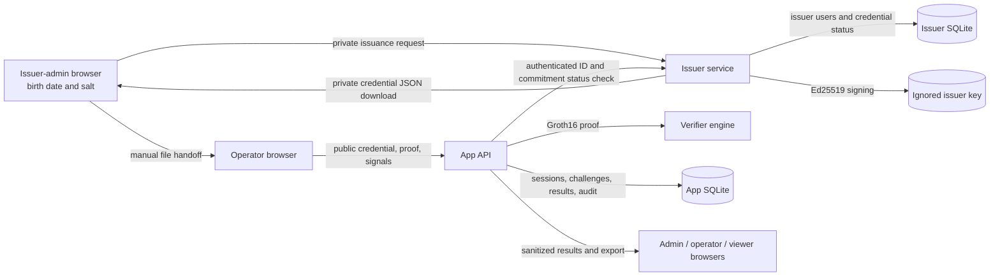

# Draft data flow and threat model

This is a team review worksheet for the local age-18 demo. The instructor's approved fixture and threat-model scope are still pending. The table separates protections already present in code from protections that the HTTP and database work must add.

In the planned full flow, the issuer-admin browser and private file are inside the private-witness boundary. The app verifier receives only the six public credential fields, a proof, and four public signals. The app and issuer run as separate processes with separate databases and communicate through an authenticated loopback status request. The app's audit and result stores contain sanitized decision data. The local demo runs under one operating-system account unless the team configures stronger process isolation.

| Threat | Trust boundary and attack | Mitigation | Evidence and current state |
| --- | --- | --- | --- |
| T01 Forged credential | Operator submits a commitment without an issuer attestation. | Verify Ed25519 over the five domain-separated signed fields with the configured issuer public key before accepting a proof. | Shared encoder and fixed vectors implemented; HTTP verification pending. |
| T02 Chosen or invalid birth date | Prover changes the private date or uses a nonexistent calendar date. | Issuer validates the date and signs its Poseidon commitment; circuit proves the witness opens that commitment and meets the cutoff. | Date validation, circuit, and synthetic proof tests implemented; issuance integration pending. |
| T03 Proof or challenge substitution | Attacker swaps commitment, cutoff, challenge hash, or request tag. | Check every public signal against signed metadata and the stored challenge; recompute request tag. | Parser and binding helper implemented; database challenge lookup pending. |
| T04 Replay and concurrent use | Two submissions reuse one challenge or a used challenge survives restart. | Persist challenge state in SQLite; consume with the decision/audit record in one transaction, allowing only the agreed issuer-outage retry. | Transaction and restart tests pending. |
| T05 Unauthorized role use | Viewer exports, operator changes rules, or app admin generates proofs. | Server-side permission check on every route, generic `AUTH_DENIED`, and redacted audit event. | Role policy functions implemented; route enforcement and audit pending. |
| T06 CSRF or session theft | Browser cookie is used for an unintended write or a stale login remains valid. | Strict SameSite/httpOnly cookie, CSRF token on writes, SQLite session rotation and expiry. | Session deadline policy implemented; cookie and CSRF routes pending. |
| T07 Malformed or oversized input | Duplicate keys change the meaning of a credential/request, or large input exhausts resources. | Strict duplicate-key JSON parsing, exact schemas, 4 KB private-file and 16 KB public-request limits, parameterized SQL. | JSON parsers and tests implemented; HTTP raw-body wiring and SQL pending. |
| T08 Secret or private-data leakage | Birth date, salt, signature, commitment, key, token, or issuer response body enters logs or reports. | Private file stays in browsers, `.local/` files are ignored, ordinary logs/audits omit secret values, results/exports use allowlisted fields. | File exclusion and parser boundaries implemented; browser flow, logs, and export tests pending. |
| T09 Revocation bypass or issuer outage | App accepts a revoked credential or treats a broken status service as active. | Authenticated loopback status call after signature check; definitive revoked/unknown consume, infrastructure failure denies with `ISSUER_UNAVAILABLE` and leaves challenge retryable. | Status client/router and loopback tests implemented; issuer-record lookup and verifier transaction pending. |
| T10 Audit tampering or silent purge | A decision is edited/deleted without trace. | Append-only events, restricted audit read, scheduled retention purge that emits its own event. | Data model, purge job, and immutability tests pending. |
| T11 Signing-key compromise | App or another local process reads the issuer private key. | Keep private key in ignored issuer config, never expose through routes; use separate OS identities and managed secrets outside the demo. | Local setup preserves ignored key; same-account isolation limitation documented. |

For each case, Member D records the final test ID, expected outcome, actual outcome, sanitized evidence location, and pass/fail. The team should revise this worksheet after the full HTTP and database flow is built.
